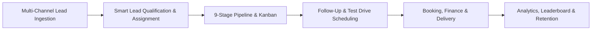
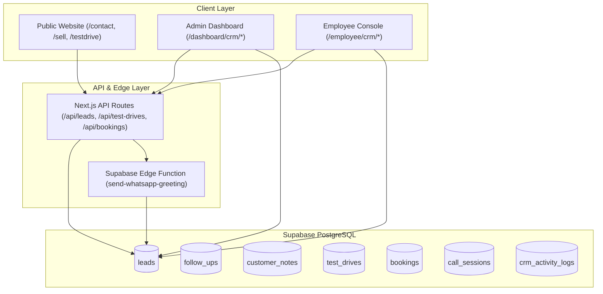
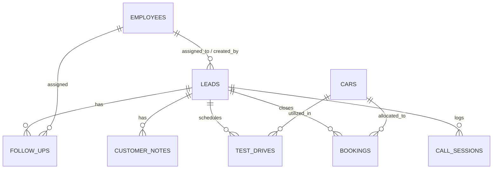
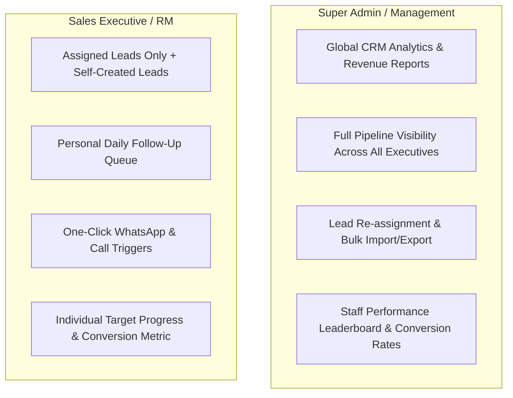
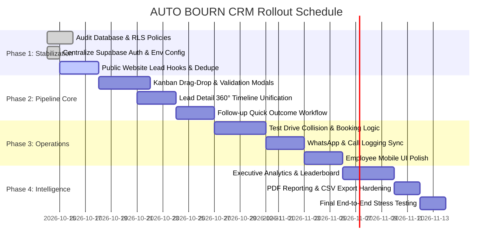

# AUTO BOURN — CRM Implementation Plan

## 1. Executive Summary & Vision
AUTO BOURN Cars is a premier pre-owned luxury automobile dealership. The Customer Relationship Management (CRM) platform is designed to manage the high-touch, consultative sales lifecycle of luxury car buyers—from first inquiry to test drive, financing, delivery, and post-sale retention.

### Key Business Goals
1. **Zero Lead Leakage**: Capture 100% of inquiries across website, WhatsApp, phone calls, walk-ins, and social campaigns with automatic deduplication.
2. **Standardized Pipeline**: Move leads through a defined 9-stage qualification cycle with audit trails.
3. **Proactive Follow-Ups**: Ensure every hot and warm prospect receives timely communication via call, WhatsApp, or email.
4. **Transparent Governance**: Segregate Admin and Employee roles with granular RLS security and performance metrics.

---

## 2. System Architecture

---

## 3. Database Schema & Data Models

### 3.1 Core Entity Relationship

### 3.2 Lead Pipeline & Stages

| Stage Key | Label | Color | Criteria & Action Required |
|---|---|---|---|
| `new` | New Lead | `#6366f1` | Inbound inquiry created; awaiting first contact within 15 mins. |
| `contacted` | Contacted | `#3b82f6` | Initial call or message placed; requirement gathering in progress. |
| `interested` | Interested | `#06b6d4` | Customer confirmed vehicle preference (Brand/Budget/Fuel). |
| `follow_up_pending` | Follow-up Pending | `#f59e0b` | Specific follow-up scheduled (callback requested, budget check). |
| `test_drive_scheduled` | Test Drive Scheduled | `#8b5cf6` | Date, time, car, and showroom/home location locked. |
| `negotiation` | Negotiation | `#ec4899` | Pricing discussion, trade-in valuation, or finance calculation. |
| `booking_done` | Booking Done | `#22c55e` | Advance token received; vehicle reserved. |
| `sold` | Sold | `#E10613` | Full payment settled, RTO transferred, car delivered. |
| `lost` | Lost | `#6b7280` | Deal dropped; mandatory `lost_reason` recorded. |

### 3.3 Core Tables Overview

1. **`leads`**: Central record storing personal information, budget range, source attribution, current stage, and assigned employee.
2. **`follow_ups`**: Time-sensitive action items (Call, WhatsApp, SMS, Meeting, Test Drive) with priority (`low`, `normal`, `high`) and statuses (`pending`, `completed`, `missed`, `cancelled`).
3. **`customer_notes`**: Chronological log of conversations, customer preferences, and interaction notes.
4. **`test_drives`**: Test drive booking details, vehicle link, venue (Showroom/Home), driver license reference, feedback, and outcome.
5. **`bookings`**: Deal financials, token advance, full payment status, loan approval state, RTO status, and delivery date.
6. **`call_sessions`**: Telephony logs tracking calls made via the CRM, duration, and disposition status.
7. **`crm_activity_logs`**: Immutable audit trail of every status transition, assignment change, and deletion.

---

## 4. Role-Based Access Control (RBAC)

---

## 5. Functional Modules & Implementation Breakdown

### Module 1: Lead Capture & Ingestion Engine
- **Inbound Sources**:
  - Website vehicle inquiry modal (`/vehicle/[id]`)
  - Test drive booking page (`/testdrive`)
  - Sell car evaluation form (`/sell`)
  - General contact form (`/contact`)
  - Manual entry from showroom walk-ins (`/dashboard/crm/leads` modal)
- **Validation & De-duplication**:
  - Normalizes phone numbers to standard 10-digit / E.164 format.
  - Checks if an active lead exists for the same phone. If active, appends inquiry to `customer_notes` rather than creating a duplicate lead.
- **Instant Welcome**:
  - Triggers the Supabase Edge Function `send-whatsapp-greeting` with the customer's name and vehicle interest.

### Module 2: Visual Pipeline & Kanban Board (`/dashboard/crm/leads`)
- **Drag-and-Drop Workflow**:
  - Drag lead cards between stage columns with optimistic UI updates.
  - Interactive modal prompt when dropping onto `lost` (requiring lost reason: e.g. "Price too high", "Bought elsewhere", "Out of budget").
  - Modal prompt when dropping onto `test_drive_scheduled` to immediately capture date & vehicle.
- **Dual View Support**:
  - **Kanban View**: Visual cards grouped by status with summary counts and total budget values.
  - **Table / List View**: Sortable columns (Date, Name, Phone, Brand, Budget, Assigned To, Last Activity), multi-select bulk operations, and search.

### Module 3: Lead Detail 360° Hub (`/dashboard/crm/leads/[id]`)
- **Profile Header**: Customer contact details, direct WhatsApp launch button, direct `tel:` call button, quick stage switcher.
- **Activity Timeline**: Unified chronological stream combining status updates, system events, customer notes, call logs, and test drive outcomes.
- **Action Tabs**:
  1. *Follow-ups*: Schedule, mark complete, or reschedule pending tasks.
  2. *Notes*: Add timestamped team notes with employee tagging.
  3. *Test Drives*: Schedule and log test drive feedback.
  4. *Booking & Financials*: Record token payment, loan status, and delivery schedule.

### Module 4: Follow-up & Task Management Engine (`/dashboard/crm/follow-ups`)
- **Queue Segmentation**:
  - **Today's Follow-ups**: Action items due within the current calendar day.
  - **Missed / Overdue**: Past-due items highlighted in warning red with quick-reschedule buttons.
  - **Upcoming**: Next 7-day scheduled actions.
- **Quick Completion Modal**:
  - Allows marking a follow-up complete with outcome notes and automatic creation of the next follow-up in a single step.
- **Export Utility**:
  - One-click PDF generation for daily missed follow-ups to distribute in morning sales scrums.

### Module 5: Test Drive & Deal Closure Management
- **Test Drive Lifecycle**:
  - Real-time car inventory check (verifies car isn't already out for test drive or delivered).
  - Post-drive feedback capture (`interested`, `not_interested`, `needs_follow_up`).
- **Booking & Delivery Workflow**:
  - Advance booking creation with auto-lock on inventory status (`reserved`).
  - Milestone checklist: Token Paid -> Loan Documented -> Inspection Completed -> RTO Processed -> Handover Ceremony.

### Module 6: Executive Console Experience (`/employee/crm/*`)
- **Streamlined Mobile-Friendly Interface**:
  - Optimized for executives walking the showroom floor or taking calls on tablets/smartphones.
  - Clean cards, large touch targets for "Call" and "WhatsApp".
  - Quick-action buttons to log follow-up results in under 15 seconds.

### Module 7: Analytics & Executive Intelligence (`/dashboard/crm/analytics`)
- **Conversion Metrics**:
  - Inflow vs Conversion (Lead-to-Test Drive % and Test Drive-to-Sold %).
  - Average deal cycle duration (Days from `new` to `sold`).
- **Lead Source ROI**:
  - Breakdown of leads and conversions across Website, Instagram, Walk-in, OLX, and Referrals.
- **Sales Rep Leaderboard**:
  - Number of calls made, test drives conducted, bookings achieved, and revenue closed per executive.

---

## 6. Phased Implementation Roadmap

### Detailed Phase Deliverables

#### Phase 1: Foundation, Security & Lead Ingestion
- [x] Configure Supabase production environment variables and client fallbacks.
- [ ] Connect public site forms (`/testdrive`, `/sell`, `/contact`, car detail modal) directly to `POST /api/leads`.
- [ ] Enforce de-duplication: matching phone numbers update customer history rather than creating duplicate leads.
- [ ] Verify Row Level Security (RLS) policies for `leads`, `follow_ups`, and `bookings`.

#### Phase 2: Pipeline & Follow-up Workflow Refinement
- [ ] Implement drag-and-drop state guards on `/dashboard/crm/leads` (mandatory lost reason, mandatory test drive date).
- [ ] Unify `/dashboard/crm/leads/[id]` timeline with real-time Supabase subscriptions.
- [ ] Add the "Complete & Schedule Next" quick-action dialog in `/dashboard/crm/follow-ups`.
- [ ] Implement browser notification triggers for follow-ups due in the next 15 minutes.

#### Phase 3: Inventory Coordination, Communications & Employee Console
- [ ] Link `test_drives` and `bookings` with live car inventory in `cars` table to prevent conflicting schedules.
- [ ] Integrate automatic WhatsApp template messaging via edge function on status updates.
- [ ] Optimize `/employee/crm` for high-speed mobile inputs with tactile haptic feedback and quick-log buttons.

#### Phase 4: Business Intelligence, Reporting & Audit
- [ ] Build the CRM conversion funnel visualization in `/dashboard/crm/analytics`.
- [ ] Add executive conversion benchmarks and target progress bars.
- [ ] Finalize automated daily missed follow-ups summary and PDF lead reports.
- [ ] Perform security audit on export endpoints and audit logs.

---

## 7. Quality Assurance & Success Criteria

| Evaluation Area | Target Standard | Verification Method |
|---|---|---|
| **Lead Ingestion Speed** | < 500ms from form submit to CRM row creation | Automated API integration tests |
| **Data Integrity** | 0 orphan follow-ups or bookings on lead deletion | Cascade FK constraint checks |
| **Notification Accuracy** | Overdue follow-up badges reflect local IST time | Date-time unit tests |
| **Mobile Usability** | 100% usable on smartphone screens (>= 375px width) | Responsive device testing |
| **Audit Traceability** | Every stage change logged in `crm_activity_logs` | Trigger verification tests |

---
*Plan maintained in the AUTO BOURN engineering workspace.*
